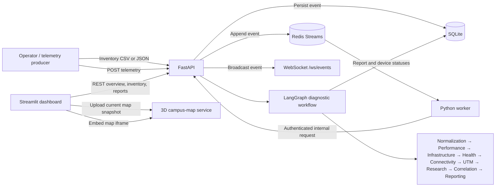

PS: 
### Blueprint Availability

During the hackathon, adding more blueprints was limited by the platform’s paid plan. Rather than imply that additional blueprints were available, we built and tested the demo using the blueprint and sample data already included in the project.

The demo still showcases the core workflow and simulation using that available data. We designed the system to support additional blueprints when access is available; the plan limit affected the amount of blueprint data we could include, not the intended scope of the solution.

The live map,simulations,and the core functionalities work, but the workers couldnt be added due to limitation of free blueprints.
You can refer to the demo video for the full functionalities.

# NetCoop AI

NetCoop AI is a network-operations demo that ingests device telemetry, evaluates it through a typed LangGraph workflow, and presents health status, diagnostic evidence, recommendations, and campus-map views.

The application is made up of:

- **Streamlit** for the operator dashboard and follow-up form.
- **FastAPI** for inventory, telemetry, diagnostics, reports, and WebSocket events.
- **Redis Streams** for asynchronous telemetry delivery and retry handling.
- **SQLite** for the demo inventory, telemetry records, reports, and operator reviews.
- **LangGraph** for a sequential set of independently implemented diagnostic agents.
- **Pydantic** models for API validation, agent state/output shapes, and LLM output parsing.
- An optional **Groq** model for weighted candidate scoring and report narrative.
- An optional **Tavily** search for external troubleshooting references.
- A separate **Flask** application for the 3D campus map.

> **Scope note:** This is a demonstration and decision-support application, not an automated network controller. Scores are heuristic confidence estimates, not statistically calibrated probabilities. Validate recommendations against device telemetry, vendor documentation, and change-control procedures before acting.

## Contents

- [How the application works](#how-the-application-works)
- [Agent-by-agent workflow](#agent-by-agent-workflow)
- [Project structure](#project-structure)
- [Requirements](#requirements)
- [Local setup](#local-setup)
- [Environment variables](#environment-variables)
- [Inventory and telemetry](#inventory-and-telemetry)
- [Human-in-the-loop follow-up](#human-in-the-loop-follow-up)
- [Dashboard and maps](#dashboard-and-maps)
- [Event simulation](#event-simulation)
- [API reference](#api-reference)
- [Tests and troubleshooting](#tests-and-troubleshooting)
- [Deployment](#deployment)
- [Limitations and production considerations](#limitations-and-production-considerations)

## How the application works



### Telemetry lifecycle

1. **Register devices first.** Upload a CSV/JSON inventory or load the sample IIT Bhubaneswar inventory. A device can have an ID, type, coordinates, and declared neighboring device IDs.
2. **Submit telemetry.** `POST /telemetry` validates the request, converts recognized input units to canonical units, stores the event in SQLite, and appends it to a Redis Stream. A successful response means it was queued, not that diagnosis has finished.
3. **Process asynchronously.** The Python worker reads the stream using a Redis consumer group and calls the API’s authenticated `/internal/process` endpoint.
4. **Run the graph.** FastAPI loads the device record, recent telemetry context, and inventory, then invokes the LangGraph workflow.
5. **Save results.** The API persists the agent report, updates device status and risk estimates, and broadcasts a notification through `/ws/events`.
6. **Review in Streamlit.** The dashboard fetches the latest overview and displays inventory status, incidents, probable causes, supporting evidence, recommendations, and the map.
7. **Answer follow-up questions if requested.** The operator selects a pending incident, supplies additional context, and submits it to the incident-information endpoint. The workflow re-runs with those answers.

The dashboard’s status is driven by **processed telemetry**. Inventory upload alone starts devices at `unknown`; the What-if Event Simulation page does not modify live telemetry or device status.

### Queue and delivery behavior

The backend and worker are Python. The queue is **Redis Streams**, not BullMQ (which is designed for Node.js). The worker uses a consumer group, acknowledges successful processing, reclaims idle pending messages, retries failures, and moves messages that reach `WORKER_MAX_DELIVERIES` to the dead-letter stream. The default streams are `netcoop:telemetry` and `netcoop:telemetry:dead`.

The worker's `BACKEND_URL` must point at the same API instance that received the event. For local development, set it to `http://127.0.0.1:8000`; for deployment, use the deployed API's internal or public base URL. A local worker pointed at the hosted API (or vice versa) will not process the local event records.

## Agent-by-agent workflow

The graph is sequential and currently runs as follows:

```text
Normalization
  → Performance
  → Infrastructure
  → Health Check
  → Connectivity
  → UTM
  → Web Research
  → Correlation
  → Simulation
  → Reporting
  → 3d map
```

Each agent is implemented in its own module under [`backend/agents/`](backend/agents/). Shared schemas are under [`backend/common/classes/`](backend/common/classes/).

- **1. Normalization Agent** 
 ​Validates the normalized telemetry event against the shared Pydantic TelemetryEvent model and rejects unsupported normalized metrics.
- **​2. Performance Agent** 
 ​Compares every supplied metric against configured normal ranges.
​Dynamic classification: Adds metrics to classifications if levels are higher or lower than normal.
​Analyzes past data to compute trend trajectories (whether metrics are actively rising or lowering).
- **​3. Infrastructure Agent** 
 ​Focuses on actionable infrastructure findings for queue drops, interface errors, and temperature, and suggests checks such as QoS/queue review, optics/cabling inspection, or rack airflow checks.
- **​4. Health Check Agent** 
 ​Evaluates the current event together with the recent telemetry window (up to two hours). Produces per-device status/risk summaries and identifies affected routers by device type.
- **​5. Connectivity Agent** 
 ​Follows declared inventory neighbor relationships to build a bounded, up-to-three-hop blast-radius and watch list. Neighbor risk decays with hop distance.
- **​6. UTM Agent** 
 ​Checks firewall-drop telemetry and whether client-provided UTM/firewall context is available. If evidence is missing, it contributes diagnostic questions for human review.
- **​7. Web Research Agent** 
 ​Skips healthy telemetry and cases matched by local rules. When enabled and no local rule matches, it queries Tavily for external references.
- **​8. Correlation Agent** 
​ Synthesizes inputs from local static rules, historical trends, performance classifications, topological blast-radius, and client feedback.
​Evaluates candidate causes and assigns exact probabilities/confidence scores to possible issues while outputting probable solutions.
- **9. Simulation Agent**
   We ask the users in advance regarding any upcoming events, and the number of people that are going to gather in one place. Then we run a simulation , in the frontend , and based on topological connection decide which devices based on the location of events , will evidently have more load, and thus overload the system . It's basically a warning/ lookahead for the administrator to keep a lookout on the critical and warned devices.
- **​10. Reporting Agent** 
 ​Holistic synthesis: Takes into account the simulation results for future overload issues, higher/lower trends, historical past data, operator-supplied extra information, static rules, web research, and nearby hopping devices/blast radius.
​Generates typed incident reports, deterministic summaries, device statuses, and downloadable files.
- **11. 3d map Agent**
  Based on the latitude longitude of the devices present, and the issues caused, the 3d model of IIT Bhubaneswar will show using emojis of 3 colors red,blue and green which devices are up and running and which are the critical points where issue is present and attention is needed.

​## Supporting Subsystems
- **​Monitoring Agent (Health Check)** : Exposed through GET /health. Keeps track of the health and execution status of all agents, checking API dependencies (Redis and SQLite), worker heartbeats, and run latencies.
- **​Human-in-the-Loop (HITL) Subsystem** : Automatically asks users further questions if critical diagnostic information is missing. If the user fails to provide the info or leaves questions unanswered, the system gracefully concludes with "no fixed issue found" or similar guarded determinations.


| Agent | Contribution |
|---|---|
| **Normalization Agent** | Validates the normalized telemetry event against the shared Pydantic `TelemetryEvent` model and rejects unsupported normalized metrics. Unit conversion is performed by the API before the event enters the graph. |
| **Performance Agent** | Compares every supplied metric with the configured normal range. Emits typed findings, severity (`healthy`, `warning`, or `critical`), and a list of baseline metrics that were not supplied. Critical thresholds are separately defined for selected metrics. |
| **Infrastructure Agent** | Focuses on actionable infrastructure findings for queue drops, interface errors, and temperature, and suggests checks such as QoS/queue review, optics/cabling inspection, or rack airflow checks. |
| **Health Check Agent** | Evaluates the current event together with the recent telemetry window (up to two hours, bounded by the query limit). Produces per-device status/risk summaries and identifies affected routers by device type. |
| **Connectivity Agent** | Follows declared inventory neighbor relationships to build a bounded, up-to-three-hop blast-radius/watch list. Neighbor risk decays with hop distance. This implementation uses the uploaded topology graph; it does **not** currently perform Redis GEOSEARCH. |
| **UTM Agent** | Checks firewall-drop telemetry and whether client-provided UTM/firewall context is available. If evidence is missing, it contributes diagnostic questions for human review. |
| **Web Research Agent** | Skips healthy telemetry and cases matched by local rules. When enabled and no local rule matches, it can query Tavily for a small set of external references. Search results are references, not verified facts about the monitored network. |
| **Correlation Agent** | Builds candidate causes from local static rules and the fact catalog, uses telemetry/history/topology/client confirmation as evidence, and ranks causes. The confidence threshold for reporting a verified cause is 90%. When configured, Groq returns a Pydantic-parsed set of factor ratings; the backend calculates the final weighted score. |
| **Reporting Agent** | Produces the typed incident report, deterministic summary, human questions, device statuses, nearby-risk list, limitations, and downloadable report content. When the Groq narrative path is available, the model may summarize but must not change scores or invent causes. |
| **Common Monitoring Agent** | Exposed through `GET /health`. Checks API dependencies (Redis and SQLite), worker heartbeat, agent readiness/last executions, and agent run latency/success. The dashboard displays these results in the Agent Control Center. This is runtime health monitoring, not a separate diagnostic graph node. |
| **Simulation Agent** | Produces simulation and gives a lookahead to the administrator to keep a lookout on certain probable overload devices at the time of event. |
| **3d map Agent** | Shows a 3d replica of IIT Bhubaneswar , with emojis showing the health of different devices along with diagnostics. |

### Correlation and confidence

The scoring weights used when model scoring is active are:

| Factor | Weight |
|---|---:|
| Local rule match | 30% |
| Cross-metric support | 25% |
| Severity | 15% |
| Recent history | 15% |
| Topology context | 5% |
| Client confirmation | 10% |

Scores are bounded heuristic estimates based on those factors. They are **not** model-calibrated real-world probabilities. Without `GROQ_API_KEY`, static rules and deterministic fallback scores are used and labeled in the incident report. Groq API or structured-output failures in cause scoring use the static fallback path; report-narrative failures retain the deterministic summary. Tavily failures are recorded in research status while local diagnosis continues.

## Robustness

Even if one or more of the connected agents are down, the others can work together to find out the exact root cause of the issues caused. The base model class will be used to carry memory throughout execution, and using human in the loop, extra information is taken from the administrator, if available, else not enough information is given as the output.
The health check agent keeps a check if the other agents are up and running and gives us a live status.

## Project structure

```text
.
├── backend/
│   ├── agents/                 # One module per LangGraph agent
│   ├── common/
│   │   ├── classes/            # Pydantic schemas and graph state types
│   │   ├── metrics.py          # Canonical units, accepted units, normal ranges
│   │   ├── rules.py            # Static causes, thresholds, actions, fact catalog
│   │   └── demo_inventory.py   # Illustrative campus sample inventory
│   ├── graph.py                # LangGraph node wiring and runtime tracking
│   ├── main.py                 # FastAPI app, persistence, API and WebSocket routes
│   ├── simulation.py           # Deterministic what-if event impact simulation
│   └── worker.py               # Redis Streams consumer and retry/dead-letter handling
├── frontend/
│   ├── streamlit_app.py        # Main Streamlit dashboard
│   └── event_simulation.py     # Event Simulation page renderer
├── iitbbs-3d-network/          # Separate Flask 3D campus-map app
├── tests/                      # API, workflow, and worker tests
├── data/                       # Local SQLite database location (created as needed)
├── docker-compose.yml          # Redis + API + worker + dashboard local stack
├── render.yaml                 # Blueprint for the separate 3D map service
├── Dockerfile
├── requirements.txt
└── README.md
```

## Requirements

- Python **3.12** recommended (the hosted map blueprint pins Python 3.12.10).
- Redis **6.2+**, Redis 7 recommended.
- Git.
- Optional: Docker Desktop for the Compose setup.
- Optional: Groq API key for LLM-assisted scoring/report narrative.
- Optional: Tavily API key for external troubleshooting references.

## Local setup

### 1. Get the code and create a virtual environment

Run commands from the repository root:

```bash
git clone https://github.com/Tirtha29/AgenticAI-Hackathon.git
cd AgenticAI-Hackathon

python3.12 -m venv .venv
source .venv/bin/activate
python -m pip install --upgrade pip
python -m pip install -r requirements.txt
```

On Windows PowerShell, activate with:

```powershell
.\.venv\Scripts\Activate.ps1
```

### 2. Start Redis

On macOS with Homebrew:

```bash
brew install redis
brew services start redis
redis-cli ping
```

The last command should print `PONG`. On Linux, install Redis using the distribution package manager and start its service. Alternatively, run `docker compose up --build` as described below.

### 3. Configure local environment

There is no committed `.env.example` in this repository. Create a local `.env` file in the project root using the [environment variables](#environment-variables) section below. For local API, worker, and dashboard, the important URL values are:

```dotenv
API_URL=http://127.0.0.1:8000
BACKEND_URL=http://127.0.0.1:8000
CAMPUS_MAP_URL=http://127.0.0.1:5000
REDIS_URL=redis://127.0.0.1:6379/0
INTERNAL_TOKEN=replace-with-a-long-random-secret
```

Generate a secret token with:

```bash
openssl rand -hex 32
```

Use the **same** `INTERNAL_TOKEN` for the API and worker. Keep `.env` private; it is ignored by Git.

### 4. Start the API, worker, dashboard, and optional map service

Run each process in a separate terminal from the repository root. Activate `.venv` in each terminal.

**Terminal 1 — FastAPI**

```bash
source .venv/bin/activate
uvicorn backend.main:app --reload --host 127.0.0.1 --port 8000
```

**Terminal 2 — Redis Streams worker**

```bash
source .venv/bin/activate
python -m backend.worker
```

**Terminal 3 — Streamlit dashboard**

```bash
source .venv/bin/activate
streamlit run frontend/streamlit_app.py --server.address 127.0.0.1 --server.port 8501
```

**Terminal 4 — Optional local 3D campus map**

The dashboard has a built-in fallback map, so this service is optional for local use. To run the separate 3D app:

```bash
cd iitbbs-3d-network
python3.12 -m venv .venv
source .venv/bin/activate
python -m pip install -r requirements.txt
python app.py
```

Set `CAMPUS_MAP_URL=http://127.0.0.1:5000` in the root `.env` before starting Streamlit. The local map service has its own dependencies in `iitbbs-3d-network/requirements.txt`.

Open:

- Dashboard: <http://127.0.0.1:8501>
- FastAPI interactive docs: <http://127.0.0.1:8000/docs>
- API health and agent status: <http://127.0.0.1:8000/health>
- Telemetry schema and accepted units: <http://127.0.0.1:8000/telemetry/schema>
- 3D map health (if running): <http://127.0.0.1:5000/api/buildings>

### Docker Compose alternative

Docker Compose starts Redis, the API, worker, and Streamlit dashboard:

```bash
docker compose up --build
```

Then open <http://localhost:8501> and <http://localhost:8000/docs>. Compose uses service DNS (`redis`, `api`) internally, so do not replace the container `BACKEND_URL` with `localhost`. The 3D map is not included in the Compose stack; run it separately and configure `CAMPUS_MAP_URL` if desired.

To stop the Compose services, press `Ctrl+C`, then run:

```bash
docker compose down
```

To remove persisted development volumes too (this deletes the local Compose Redis and SQLite data):

```bash
docker compose down --volumes
```

## Environment variables

Set these in a root `.env` for local processes or in the hosting provider's environment settings for deployment. The Streamlit frontend reads `API_URL` and `CAMPUS_MAP_URL` from process environment variables and otherwise uses its built-in hosted defaults.

| Variable | Required? | Purpose / default |
|---|---|---|
| `API_URL` | No | FastAPI base URL used by Streamlit; defaults to `https://netcoopai.onrender.com`. Set to `http://127.0.0.1:8000` locally. |
| `BACKEND_URL` | No | FastAPI base URL used by the worker's internal processing call; defaults to `https://netcoopai.onrender.com`. Set to the API that accepted the event. |
| `CAMPUS_MAP_URL` | No | Separate 3D map service origin; defaults to `https://netcoopai-campus-map.onrender.com`. Use `http://127.0.0.1:5000` for a local map. |
| `REDIS_URL` | No | Redis connection URL; defaults to `redis://localhost:6379/0`. Use the same Redis instance for API and worker. Hosted TLS Redis URLs often begin with `rediss://`. |
| `INTERNAL_TOKEN` | **Set a private value** | Shared secret for worker-to-API `/internal/process` calls. API and worker values must match. Do not use the development default in production. |
| `DATABASE_PATH` | No | SQLite file path; defaults to `./netcoop.db`. Configure a persistent disk/path in hosting or the database may be lost when an instance restarts. |
| `GROQ_API_KEY` | No | Enables Groq-based factor ratings and report narrative. Leave empty to use static scoring. |
| `GROQ_MODEL` | No | Groq model name; defaults to `llama-3.3-70b-versatile`. Must be available to the configured account. |
| `TAVILY_API_KEY` | No | Enables external search references when local rules do not match abnormal telemetry. |
| `TELEMETRY_STREAM` | No | Redis stream name; defaults to `netcoop:telemetry`. Must match API and worker. |
| `TELEMETRY_CONSUMER_GROUP` | No | Worker consumer group; defaults to `netcoop-workers`. |
| `WORKER_MAX_DELIVERIES` | No | Failed processing attempts before dead-lettering; defaults to `5`. |
| `WORKER_BLOCK_MS` | No | Redis blocking read interval; defaults to `5000` milliseconds. |
| `WORKER_CLAIM_IDLE_MS` | No | Minimum idle time before an unacknowledged message may be reclaimed; defaults to `30000` milliseconds. |
| `WORKER_HEARTBEAT_KEY` | No | Redis key used to report worker liveness; defaults to `netcoop:worker:heartbeat`. |
| `LOG_LEVEL` | No | Python worker log level; defaults to `INFO`. |

Example local `.env`:

```dotenv
API_URL=http://127.0.0.1:8000
BACKEND_URL=http://127.0.0.1:8000
CAMPUS_MAP_URL=http://127.0.0.1:5000
REDIS_URL=redis://127.0.0.1:6379/0
INTERNAL_TOKEN=replace-with-a-long-random-secret
DATABASE_PATH=./data/netcoop.db
GROQ_API_KEY=
GROQ_MODEL=llama-3.3-70b-versatile
TAVILY_API_KEY=
TELEMETRY_STREAM=netcoop:telemetry
TELEMETRY_CONSUMER_GROUP=netcoop-workers
WORKER_MAX_DELIVERIES=5
```

## Inventory and telemetry

### Load or upload the device inventory

In the dashboard sidebar, use **Load 15 synthetic IIT Bhubaneswar devices** for the illustrative sample, or upload a CSV or JSON inventory. Loading the sample replaces the current inventory. Sample coordinates and device measurements are synthetic and are not surveyed or operational site data.

Supported uploads are CSV or JSON, limited to 10 MB by the API.

Example CSV:

```csv
device_id,name,device_type,vendor,latitude,longitude,neighbors
RTR-01,Campus Router,router,ExampleVendor,20.1516,85.6758,SW-01;FW-01
SW-01,Core Switch,switch,ExampleVendor,20.1520,85.6762,RTR-01;AP-01
AP-01,Library AP,access point,ExampleVendor,20.1524,85.6765,SW-01
FW-01,Perimeter Firewall,firewall,ExampleVendor,20.1512,85.6752,RTR-01
```

`device_id` is required. `name`, `device_type`, `vendor`, `latitude`, `longitude`, and connections are optional. Connection lists can be given using `neighbors`, `connected_to`, `connections`, or `neighbors_json`; string lists can be comma- or semicolon-separated. Referenced neighbors must exist in the current inventory or in the same upload. Devices without valid coordinates can still be ingested, but cannot be placed on a geospatial map.

The dashboard marks newly ingested inventory devices as **unknown**. Their health changes after the worker successfully processes telemetry.

### Telemetry schema and canonical units

Use `GET /telemetry/schema` for the complete current metrics list, accepted source units, and normal ranges. The API converts values to canonical units before workflow processing:

- Bandwidth: `Mbps` (accepts Mbps, Gbps, Kbps, bps)
- Latency and jitter: `ms` (accepts ms, seconds, microseconds)
- CPU, memory, link utilization, packet loss: `%` (utilization also accepts a `fraction`)
- Temperature: `°C`
- Queue drops, interface errors, firewall drops: packets, errors, or events

Example request (2.5 Gbps is normalized to 2500 Mbps):

```bash
curl -X POST http://127.0.0.1:8000/telemetry \
  -H 'Content-Type: application/json' \
  -d '{
    "device_id": "RTR-01",
    "metrics": {
      "bandwidth": 2.5,
      "latency_ms": 35,
      "packet_loss_pct": 0.2,
      "cpu_utilization_pct": 48
    },
    "units": {
      "bandwidth": "Gbps",
      "latency_ms": "ms",
      "packet_loss_pct": "%",
      "cpu_utilization_pct": "%"
    }
  }'
```

The API responds with HTTP `202` and an `event_id` when the event is queued. Query `GET /overview` after worker processing to see the report and updated status. A telemetry `status` field from a synthetic producer is not used as the health decision; the workflow evaluates normalized metrics.

The dashboard's **Client telemetry** uploader and **Synthetic telemetry** controls can also submit events. Synthetic sample scenarios are useful for a demo but should not be confused with real device data.

## Human-in-the-loop follow-up

When evidence is missing and a cause cannot be verified at the configured 90% threshold, the correlation/reporting workflow returns a pending review and questions. On the dashboard, the **pending follow-up** area lists incidents that still have questions. Choose an incident, answer the available UTM/firewall, interface-error, route-change, and event-context prompts, then select **Submit client information**.

Submission calls:

```text
POST /incidents/{incident_id}/information
```

The API validates the answers, combines them with previous answers, re-runs the workflow, persists the updated report/device status, and broadcasts the new incident report. If questions remain, the incident remains pending and can be answered again. A successful HTTP `200` means the request was processed; inspect the returned `status` (`processed` or `needs_human`) and report questions to understand whether more information is required.

## Dashboard and maps

The Streamlit app includes:

- Overview KPIs and health distribution.
- A campus map showing device statuses and likely issue zones.
- Live network map and inventory pages.
- Event Simulation (what-if scenarios).
- Agent Control Center with health and recent execution latency.
- Incident investigation, ranked causes, evidence, and recommendations.
- Pending HITL follow-up form.
- Searchable static diagnostic rule/fact catalog.
- Analytics, unit settings, and a dark-theme toggle.

The 3D map is a **separate web application**. The Streamlit dashboard sends the current inventory/status snapshot to the map service and embeds the returned inventory view in an iframe. Because an iframe runs in the user's browser, `localhost` only works when the dashboard and browser are on the same machine. For cloud deployment, the map service must have a public HTTPS URL and `CAMPUS_MAP_URL` must point to it.

The map service exposes `/api/buildings` as its Render health-check endpoint and `/api/inventory/{inventory_id}` for map snapshots. If the hosted map service is unavailable, the dashboard warns and uses its available fallback rendering path where applicable.

### Local WebSocket events

FastAPI exposes `GET /ws/events` as a WebSocket endpoint for event notifications. Events include telemetry queued and completed incident reports (and review notifications). It is a notification channel; clients should still fetch REST endpoints such as `/overview` for the current authoritative state. The Redis stream remains the telemetry-processing queue.

## Event simulation

The **Event Simulation** page and API estimate the impact of an event such as a festival, sports event, livestream, exam, or outage on the connected inventory. It can show simulated load, projected device impact, timelines, and mitigation suggestions. Simulation is a deterministic what-if model with assumed capacity/traffic parameters; it does not write telemetry, incidents, or device health.

Relevant endpoints:

- `GET /simulation/presets`
- `POST /simulation/run`

Example:

```bash
curl -X POST http://127.0.0.1:8000/simulation/run \
  -H 'Content-Type: application/json' \
  -d '{
    "event_type": "festival",
    "anchor_device_id": "SW-01",
    "latitude": 20.1520,
    "longitude": 85.6760,
    "attendance": 6000,
    "radius_hops": 2
  }'
```

Load an inventory before running a simulation. The simulator supports at most 1,500 devices and validates event parameters.

## API reference

Interactive API reference is available at `/docs` when the API is running. The core routes include:

| Method | Route | Purpose |
|---|---|---|
| `GET` | `/health` | API, database, Redis, worker heartbeat, agent health and configuration status |
| `GET` | `/telemetry/schema` | Metric aliases, accepted/canonical units, and normal ranges |
| `POST` | `/telemetry` | Validate, normalize, persist, and enqueue telemetry |
| `POST` | `/devices/upload` | Upload a CSV or JSON device inventory |
| `POST` | `/devices/demo/iit-bhubaneswar` | Replace inventory with the illustrative sample |
| `GET` | `/overview` | Current devices, recent processed reports, and queue depth |
| `GET` | `/knowledge/rules` | Search static diagnostic rules and facts |
| `POST` | `/incidents/{incident_id}/information` | Submit client/operator context and rerun diagnostics |
| `POST` | `/incidents/{incident_id}/review` | Record an operator confirmation/rejection review |
| `GET` | `/incidents/{incident_id}/report` | Download the incident report |
| `GET` | `/simulation/presets` | List simulation presets |
| `POST` | `/simulation/run` | Run an isolated what-if simulation |
| `WS` | `/ws/events` | Receive transient event notifications |
| `POST` | `/internal/process` | Authenticated worker callback; not a public ingestion route |

## Tests and troubleshooting

Run all tests from the project root with the virtual environment active:

```bash
python -m unittest discover -s tests -v
```

Useful focused test commands:

```bash
python -m unittest tests.test_backend -v
python -m unittest tests.test_api -v
python -m unittest tests.test_worker -v
```

### Common issues

**Devices remain `unknown`**

- Confirm telemetry was accepted (`POST /telemetry` returns `202`).
- Confirm the worker is running and uses the same Redis URL and stream as the API.
- Confirm worker `BACKEND_URL` points to the exact API that stored the telemetry.
- Check `/health` for Redis, worker heartbeat, and agent status.
- Allow the asynchronous worker to process the event, then refresh `/overview` or the dashboard.

**Telemetry is queued but never processed**

- Inspect worker logs and Redis availability.
- Check `INTERNAL_TOKEN` matches between API and worker.
- Check the dead-letter stream (`netcoop:telemetry:dead` by default); exhausted entries are not automatically replayed.
- Do not assume that changing `.env` reconfigures already running processes; restart the API and worker after configuration changes.

**Groq error or static fallback shown**

- Confirm `GROQ_API_KEY` is valid and `GROQ_MODEL` is available to that key/account.
- Without a configured key, static scoring is the expected path.
- The report's `scoring_method` and `limitations` fields identify the scoring path.

**3D map is blank or disconnected**

- Open `CAMPUS_MAP_URL/api/buildings` directly and confirm it returns HTTP 200.
- Verify the Streamlit process has the exact map origin in `CAMPUS_MAP_URL`.
- Use a public HTTPS map URL for Streamlit Cloud; do not use a server's localhost address from a remote browser.
- Confirm devices have valid latitude and longitude and that map inventory IDs are current.

**Streamlit cannot import the frontend**

- Set the Streamlit main file to `frontend/streamlit_app.py`.
- Install dependencies from the repository-root `requirements.txt`.
- Run Streamlit from the repository root so the `frontend` and `backend` packages are available.

## Deployment

The services have separate deployment responsibilities:

1. **FastAPI API:** deploy `backend.main:app` with a reachable Redis service, shared `INTERNAL_TOKEN`, and persistent storage for `DATABASE_PATH`.
2. **Python worker:** run `python -m backend.worker`; configure the same `REDIS_URL`, `TELEMETRY_STREAM`, `TELEMETRY_CONSUMER_GROUP`, and `INTERNAL_TOKEN` as the API. Set `BACKEND_URL` to that deployed API.
3. **Streamlit Community Cloud:** select this repository and set the main file to `frontend/streamlit_app.py`. The frontend defaults to `https://netcoopai.onrender.com` for the API and `https://netcoopai-campus-map.onrender.com` for the 3D map, so no URL override is needed when those are the deployed service URLs.
4. **3D map:** deploy `iitbbs-3d-network` as its own Python web service. The root [`render.yaml`](render.yaml) defines the map service Blueprint, with the map directory as its root. The Streamlit app expects the map service's public HTTPS origin.

The API and worker must share the same Redis instance and internal token. The frontend only needs the public API and map URLs; it must not receive Groq/Tavily keys or the internal worker token. The frontend currently reads URL overrides from process environment variables rather than `st.secrets`; if your Streamlit host only provides secret values, retain the built-in hosted defaults or update the app configuration to load those secrets before relying on overrides. The repository's Render Blueprint currently configures the **map service**; deploy the API and worker separately unless you add corresponding service definitions to the Blueprint.

## Limitations and production considerations

- SQLite is suitable for the demo, not high-concurrency production deployment. Use a managed database and migrations for production.
- The current health/history views are bounded by query limits and are not a full telemetry time-series platform.
- Connectivity risk is inferred from declared neighbor relationships, not measured link state or Redis geospatial distance.
- Geospatial map placement requires coordinates; missing coordinates cannot be shown.
- Static rules, synthetic inventory, generated examples, model scores, and event simulation assumptions require validation before operational decisions.
- Agent execution health is process-local runtime state and is not durable across API restarts.
- Secure the API before exposing it publicly: use HTTPS, authentication/authorization, rate limiting, secret management, network policies, and appropriate audit retention.
- Configure persistent storage for SQLite if it is used in a hosted demo; ephemeral filesystems can lose the database after restarts or redeployments.
